<!-- Artwork is generated by scripts/design/build.py from the portfolio's fonts, colours and content. -->

<a href="https://saadnazir.msndev.workers.dev/">
  <picture>
    <source media="(prefers-color-scheme: dark)" srcset="assets/header-dark.svg" />
    
  </picture>
</a>

  <a href="https://saadnazir.msndev.workers.dev/"><picture><source media="(prefers-color-scheme: dark)" srcset="assets/btn-explore-dark.svg" />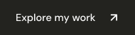</picture></a>
  <a href="https://saadnazir.msndev.workers.dev/Saad-Nazir-Resume.pdf"><picture><source media="(prefers-color-scheme: dark)" srcset="assets/btn-resume-dark.svg" />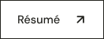</picture></a>

<picture>
  <source media="(prefers-color-scheme: dark)" srcset="assets/stats-dark.svg" />
  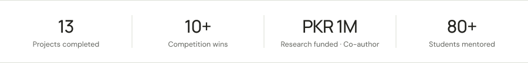
</picture>

  

<picture>
  <source media="(prefers-color-scheme: dark)" srcset="assets/h-work-dark.svg" />
  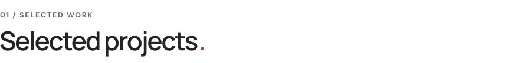
</picture>

<a href="https://saadnazir.msndev.workers.dev/work/mill-ledger/">
  <picture>
    <source media="(prefers-color-scheme: dark)" srcset="assets/card-mill-ledger-dark.svg" />
    
  </picture>
</a>

<a href="https://saadnazir.msndev.workers.dev/work/ucp-noticeboard/">
  <picture>
    <source media="(prefers-color-scheme: dark)" srcset="assets/card-ucp-noticeboard-dark.svg" />
    
  </picture>
</a>

UCP Noticeboard: <a href="https://ucp-noticeboard.msndev.workers.dev/">open the web app</a> · <a href="https://chromewebstore.google.com/detail/dmkdgckajefikfbbfblihmnamjiaemfg">Chrome extension</a> · <a href="https://github.com/saad-nazir-0289/ucp-noticeboard">source code</a>

  <a href="https://saadnazir.msndev.workers.dev/projects/"><picture><source media="(prefers-color-scheme: dark)" srcset="assets/btn-projects-dark.svg" />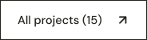</picture></a>

 

<picture>
  <source media="(prefers-color-scheme: dark)" srcset="assets/h-about-dark.svg" />
  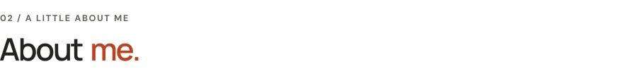
</picture>

<picture>
  <source media="(prefers-color-scheme: dark)" srcset="assets/about-dark.svg" />
  
</picture>

  <a href="https://saadnazir.msndev.workers.dev/journey/"><picture><source media="(prefers-color-scheme: dark)" srcset="assets/btn-journey-dark.svg" />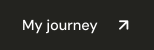</picture></a>
  <a href="https://saadnazir.msndev.workers.dev/certifications/"><picture><source media="(prefers-color-scheme: dark)" srcset="assets/btn-certifications-dark.svg" />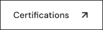</picture></a>

 

<picture>
  <source media="(prefers-color-scheme: dark)" srcset="assets/h-now-dark.svg" />
  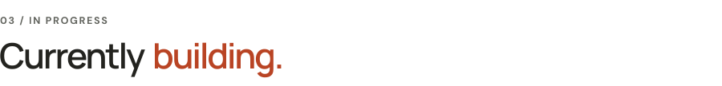
</picture>

  <a href="https://saadnazir.msndev.workers.dev/work/ucp-gate-vision/">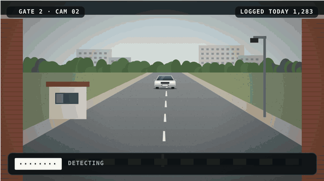</a>
  <a href="https://saadnazir.msndev.workers.dev/work/agrivision/">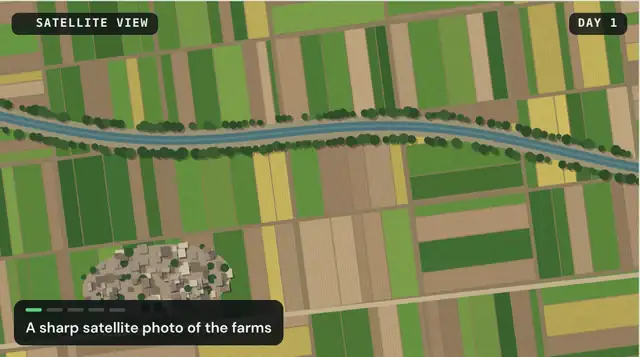</a>

  <a href="https://saadnazir.msndev.workers.dev/work/ucp-gate-vision/"><picture><source media="(prefers-color-scheme: dark)" srcset="assets/now-gate-vision-dark.svg" />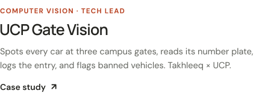</picture></a>
  <a href="https://saadnazir.msndev.workers.dev/work/agrivision/"><picture><source media="(prefers-color-scheme: dark)" srcset="assets/now-agrivision-dark.svg" />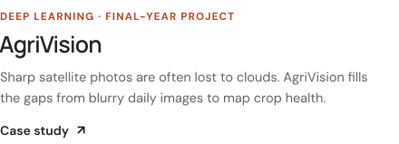</picture></a>

 

<picture>
  <source media="(prefers-color-scheme: dark)" srcset="assets/h-blog-dark.svg" />
  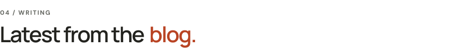
</picture>

<a href="https://saadnazir.msndev.workers.dev/blogs/predicting-rare-spikes/">
  <picture>
    <source media="(prefers-color-scheme: dark)" srcset="assets/blog-1-dark.svg" />
    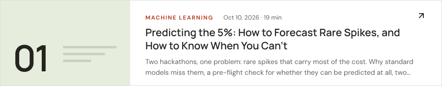
  </picture>
</a>

<a href="https://saadnazir.msndev.workers.dev/blogs/building-mill-ledger/">
  <picture>
    <source media="(prefers-color-scheme: dark)" srcset="assets/blog-2-dark.svg" />
    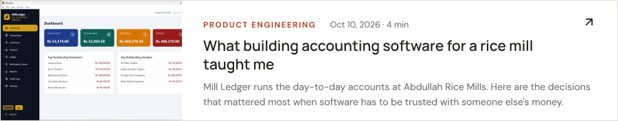
  </picture>
</a>

  <a href="https://saadnazir.msndev.workers.dev/blogs/"><picture><source media="(prefers-color-scheme: dark)" srcset="assets/btn-blog-dark.svg" />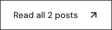</picture></a>

 

<picture>
  <source media="(prefers-color-scheme: dark)" srcset="assets/h-toolbox-dark.svg" />
  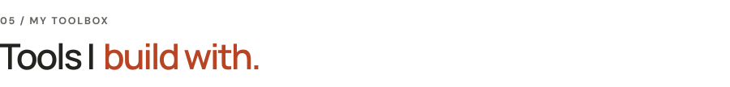
</picture>

<picture>
  <source media="(prefers-color-scheme: dark)" srcset="assets/toolbox-dark.svg" />
  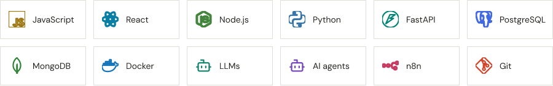
</picture>

  

<picture>
  <source media="(prefers-color-scheme: dark)" srcset="assets/h-contact-dark.svg" />
  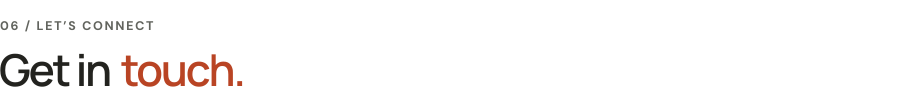
</picture>

<a href="mailto:saadnazir099@gmail.com">
  <picture>
    <source media="(prefers-color-scheme: dark)" srcset="assets/contact-dark.svg" />
    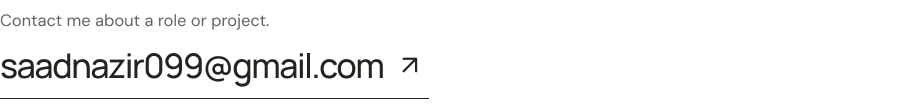
  </picture>
</a>

  <a href="https://www.linkedin.com/in/saad-nazir0289"><picture><source media="(prefers-color-scheme: dark)" srcset="assets/btn-linkedin-dark.svg" />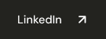</picture></a>
  <a href="https://saadnazir.msndev.workers.dev/"><picture><source media="(prefers-color-scheme: dark)" srcset="assets/btn-website-dark.svg" />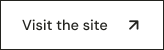</picture></a>

Lahore, Pakistan · Available remotely · Backup copy of my <a href="./Saad-Nazir-Resume.pdf">résumé</a>
